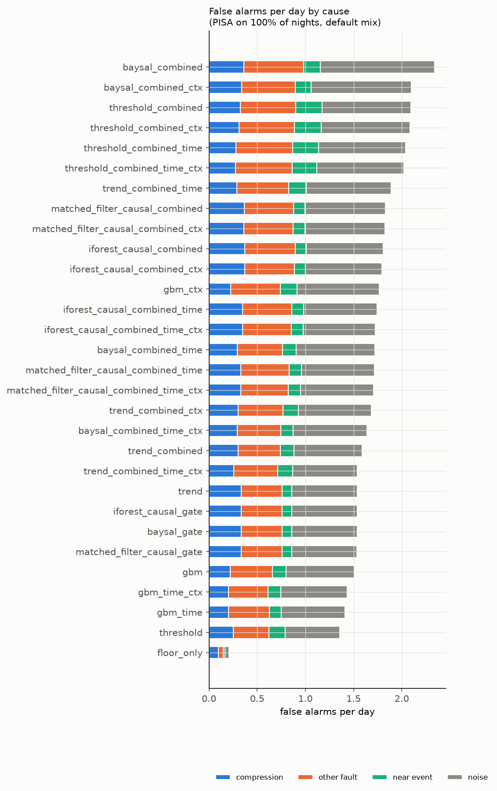

# Results on one page

For clinicians. Every result is simulated: 30 virtual patients, not people with diabetes.

## What we asked

Continuous glucose monitors (CGMs, under-skin glucose sensors) can show false lows. The best-known cause is pressure on the sensor during sleep, a "compression low". We asked how many false low alarms compression causes, whether some alarm designs suffer more, and whether insulin and carb records help an alarm ignore compression.

Each virtual patient was simulated for 14 days, 5 times. Sensor faults were added to the simulated sensor, never to the true glucose, so every false alarm has a known cause. Brackets give 95% confidence intervals (CI, the plausible range).

## Where false alarms come from

*Each bar is one alarm design; blue is compression. For `threshold` and `trend` (defined in the table below), sensor noise (grey) and other faults (orange) each cause more false alarms than compression. For `floor_only`, compression is the largest cause.*

## The three basic alarms, with a compression low every night

| Alarm | False alarms per day | Of which compression | Severe lows caught | Warning before a severe low, min; missed |
|---|---|---|---|---|
| Floor only (55 mg/dL or below) | 0.21 (0.17–0.24) | 0.10 (0.08–0.12) | 36% (28%–44%) | -9 (-11 to -7); missed 64% |
| Threshold (below 70 mg/dL) | 1.36 (1.14–1.61) | 0.25 (0.21–0.30) | 86% (80%–91%) | 3 (1 to 5); missed 14% |
| Trend (predicts 55 in 20 min) | 1.54 (1.33–1.77) | 0.33 (0.31–0.37) | 90% (85%–93%) | 7 (3 to 16); missed 10% |

A severe low is glucose below 54 mg/dL for 15 minutes. A negative warning means the alarm typically fired after the low began.

## What we found

- **Compression is a minor cause.** Even with a compression low every night, it was credited with about 22% of the trend alarm's false alarms, and caused about 18% (against the same runs without compression).
- **Trend alarms suffer a little more.** From no compressed nights to all, trend alarms gained 0.09 (0.07–0.11) more false alarms per day than threshold alarms: about one extra every 12 days.
- **Insulin and carb records did not help enough.** The bar, set in advance, was a 25% cut in compression false alarms. None met it; the best was gradient boosting on the standard mix, 0.82 (0.75–0.90), inconclusive.
- **Fewer compression alarms cost severe lows** (post hoc: decided after the main results). Published detectors removed compression alarms only by missing severe lows. The first clear cut, by the Baysal 2014 detector, to 0.89 (0.80–0.98) times as many, missed 11 more of 249. Compared at the same sensitivity, matched after the fact, none gave fewer false alarms than simply making the trend alarm less sensitive (19 of 60 planned comparisons were possible).
- **A model-based filter did no better (exploratory).** A Kalman filter (a sensor-tracking model) with a "compressed" state raised about as many false alarms as the best learned alarm, 0.94 (0.81–1.09), and as itself without that state, 1.00 (0.84–1.20). With the switching between states corrected (A18), its earlier advantage over the learned alarm, 0.88 (0.80–0.98), is gone.
- **Real data could not settle the insulin and carb question.** On real overnight records with injected compression, every confidence interval included no effect.

## What this does and does not mean

These results describe a simulator, not patients. Simulated lows are its weakest part, because the model lacks the body's own defence against lows. Thresholds and the cost of a missed low await clinical review.

**Not a medical device. Not for treatment decisions.** If a reading looks wrong, confirm with a fingerstick and follow your care team's advice.

## Next

- [Claims for a clinician to check](CLINICAL_REVIEW.md)
- [Every limitation](reference/RESEARCH.md#6-known-limitations-to-state-up-front)
- [Every result](../results/README.md)
