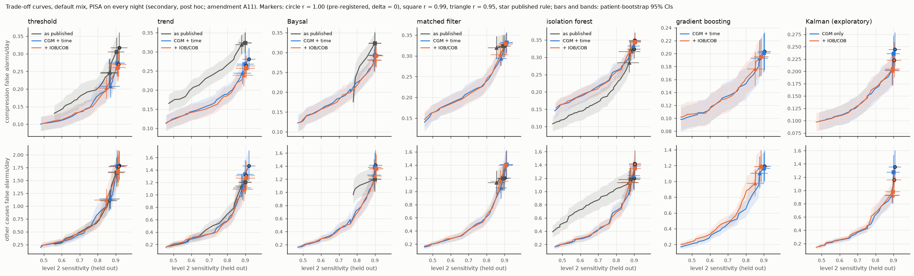
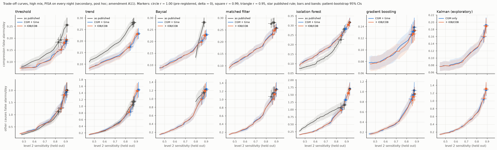
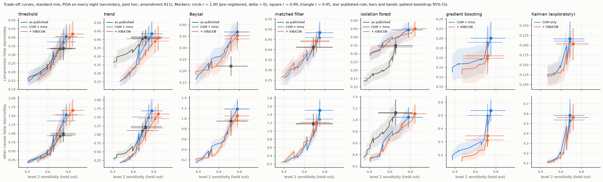
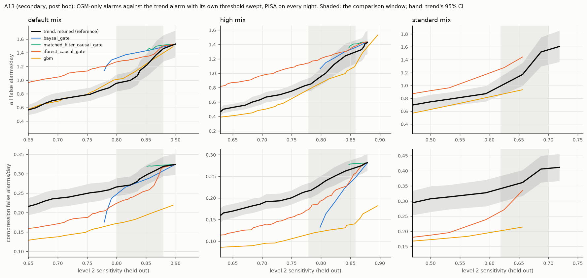
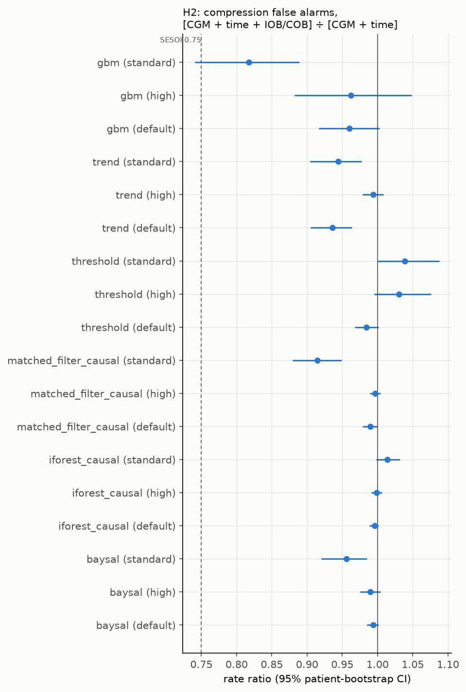
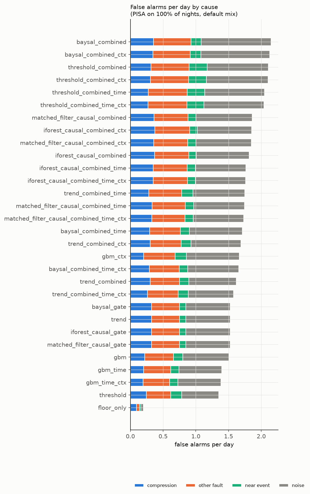
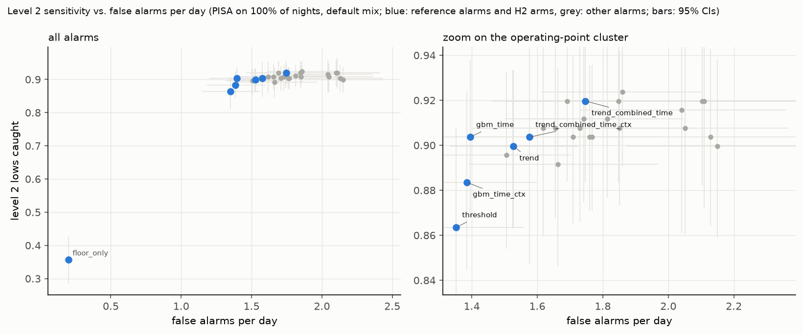
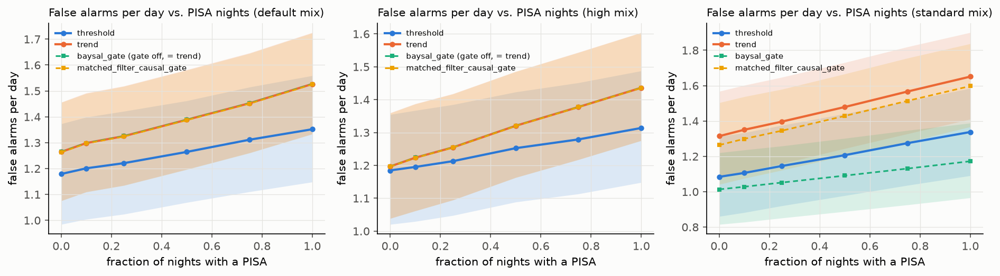
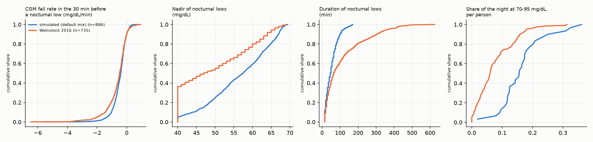

# Results

Every benchmark result, for anyone checking a claim. Generated by `experiments/make_results_readme.py` from the tables in `results/tables/`; do not edit by hand. Regenerate everything with `make results`.
Benchmark version: `ghostlows-bench v1`. Simulated cohort: 30 virtual patients (UVA/Padova 2008 via simglucose), 14 days, 5 seeds, three scenario mixes. Confidence intervals are 95% patient-bootstrap intervals over this cohort, not a population (BENCHMARK.md §6).

Training fault level (D19): PISA on 86% of nights (realistic default from Lobo 2026's rate; reachable: True; rate with a PISA every night 0.371 per day vs. target 0.321).

## Summary

Read mechanically from the tables below, with the rules of docs/reference/RESEARCH.md §3 (H1, H2) and amendment A4 (H3); nothing in this section is typed by hand.

- **H1** (trend alarms degrade faster than threshold alarms as compression nights increase; median per-patient slope difference, false alarms/day per unit PISA fraction): default: 0.09 (0.07–0.10), supported; high: 0.11 (0.08–0.14), supported; standard: 0.08 (0.06–0.11), supported. Size of the effect (default mix): going from no compressed nights to a PISA on every night adds 0.09 more false alarms per day to `trend` than to `threshold`, about one extra false alarm every 11 days. Supported, but small.
- **H2** (default mix, PISA on 100% of nights; compression false alarms with IOB/COB ÷ without, SESOI 0.75): no meaningful reduction: `baysal`, `gbm`, `iforest_causal`, `matched_filter_causal`, `threshold`, `trend`.
- **H2, secondary** (the ratio is closer to 1 on the high-perturbation mix than on the standard mix): 6 of 6 detectors (point estimates; no CI on the difference).
- **H3** (the context benefit is closer to 1 on real AZT1D nights than in simulation, matched mix `high`, PISA on 100% of nights; descriptive, A4): holds for 3 of 6 detectors. Uninformative here: on the matched mix the simulation itself shows no meaningful context benefit (every reading 'no meaningful reduction'), so there is no benefit for real data to shrink. AZT1D users are on automated insulin delivery, not the open-loop target population (D9).
- **Trade-off curves** (secondary, post hoc, amendment A11; default mix; r = training sensitivity kept relative to `trend`): the gates start removing compression false alarms at `baysal_gate` from r = 0.88, compression false alarms × 0.891 (0.809–0.965) for 11 more missed level 2 lows of 249; `iforest_causal_gate` from r = 0.99, compression false alarms × 0.978 (0.959–0.994) for 5 more missed level 2 lows of 249; `matched_filter_causal_gate` from r = 0.97, compression false alarms × 0.991 (0.983–0.997) for 8 more missed level 2 lows of 249. Readings at r = 0.95 and 0.99 match the pre-registered r = 1.00 reading for every detector and mix. No detector reaches a meaningful reduction at any marked point.
- **A13** (secondary, post hoc; gates and CGM-only gradient boosting vs. the trend alarm with its threshold retuned, at matched held-out level 2 sensitivity): No published gate gave fewer total false alarms than the retuned trend alarm at any estimable point; the isolation-forest and Baysal gates gave more at most (6 of 8 and 2 of 3). Comparisons are at matched held-out sensitivity (an oracle, not a deployable operating point), cover 18 of 60 planned points, are uncorrected for multiplicity and say nothing about the standard mix. The matched-filter gate could not be compared (its curve reaches only 3 of its 15 planned points, all unstable). CGM-only gradient boosting shifted false alarms between causes: fewer from compression (0.50–0.66 times the retuned trend alarm's, at 7 of its 7 points) with no detectable change in the total (ratios 0.81–1.08, every CI including 1).
- **RQ3** (exploratory; default mix, PISA on 100% of nights; `kalman_pisa`, false alarms, ratio): vs. best CGM + IOB/COB discriminative alarm 0.88 (0.80–0.98); vs. `kalman_nopisa` 1.05 (0.93–1.18); vs. `kalman_pisa_cgm` 0.87 (0.80–0.93). Compression false alarms and level 2 sensitivity: [RQ3 table](#rq3-exploratory-a-kalman-filter-with-an-explicit-compressed-state).

## Headline results

### RQ1: CGM-only alarms as compression nights increase (default mix)

False alarms per day (95% patient-bootstrap CI), other faults at moderate severity:

| Alarm | PISA nights 0% | PISA nights 10% | PISA nights 25% | PISA nights 50% | PISA nights 75% | PISA nights 100% |
|---|---|---|---|---|---|---|
| `floor_only` | 0.11 (0.09–0.14) | 0.12 (0.10–0.15) | 0.13 (0.11–0.15) | 0.15 (0.13–0.18) | 0.17 (0.15–0.20) | 0.20 (0.17–0.23) |
| `threshold` | 1.18 (0.98–1.37) | 1.20 (1.00–1.40) | 1.22 (1.02–1.42) | 1.26 (1.07–1.46) | 1.31 (1.11–1.51) | 1.35 (1.15–1.56) |
| `trend` | 1.26 (1.08–1.46) | 1.30 (1.11–1.49) | 1.33 (1.14–1.52) | 1.39 (1.20–1.58) | 1.45 (1.26–1.65) | 1.53 (1.33–1.73) |
| `baysal_gate` | 1.26 (1.08–1.46) | 1.30 (1.11–1.49) | 1.33 (1.14–1.52) | 1.39 (1.20–1.58) | 1.45 (1.26–1.65) | 1.53 (1.33–1.73) |
| `matched_filter_causal_gate` | 1.26 (1.08–1.46) | 1.30 (1.11–1.49) | 1.32 (1.13–1.52) | 1.39 (1.20–1.58) | 1.45 (1.26–1.64) | 1.53 (1.33–1.72) |
| `iforest_causal_gate` | 1.26 (1.08–1.46) | 1.30 (1.11–1.49) | 1.33 (1.14–1.52) | 1.39 (1.20–1.58) | 1.45 (1.26–1.65) | 1.53 (1.33–1.73) |

Identical to `trend` here: `baysal_gate`, `iforest_causal_gate`. `matched_filter_causal_gate` differs from `trend` by less than 0.01 false alarms/day. At the pre-registered operating point (D5, δ = 0), which allows no loss of training sensitivity against `trend`, the thresholds chosen for these gates suppress no or almost no trend alarms (`thresholds.csv`). This describes the operating point, not what the detectors can do. The trade-off curves below (secondary, post hoc; amendment A11) show what each gate removes as training sensitivity is given up, and at what cost in lows.

At the highest level (100% of nights), by cause and with lows caught:

| Alarm | Compression | Other fault | Near event | Noise | Level 1 caught | Level 2 caught | Warning before caught level 2 lows, min (95% CI); miss rate |
|---|---|---|---|---|---|---|---|
| `floor_only` | 0.09 (0.07–0.11) | 0.05 (0.04–0.06) | 0.02 (0.01–0.03) | 0.04 (0.03–0.05) | 5% (4%–7%) | 36% (28%–43%) | -9 (-10 to -6); missed 64% |
| `threshold` | 0.25 (0.21–0.29) | 0.37 (0.29–0.46) | 0.17 (0.14–0.19) | 0.57 (0.47–0.67) | 44% (40%–49%) | 86% (81%–91%) | 3 (1 to 5); missed 14% |
| `trend` | 0.32 (0.30–0.35) | 0.43 (0.36–0.50) | 0.10 (0.08–0.12) | 0.68 (0.56–0.79) | 57% (54%–61%) | 90% (86%–93%) | 7 (2 to 11); missed 10% |
| `baysal_gate` | 0.32 (0.30–0.35) | 0.43 (0.36–0.50) | 0.10 (0.08–0.12) | 0.68 (0.56–0.79) | 57% (54%–61%) | 90% (86%–93%) | 7 (2 to 11); missed 10% |
| `matched_filter_causal_gate` | 0.32 (0.30–0.35) | 0.43 (0.36–0.50) | 0.10 (0.08–0.12) | 0.68 (0.56–0.79) | 57% (53%–61%) | 90% (86%–93%) | 6 (2 to 9); missed 10% |
| `iforest_causal_gate` | 0.32 (0.30–0.35) | 0.43 (0.36–0.50) | 0.10 (0.08–0.12) | 0.68 (0.56–0.79) | 57% (54%–61%) | 90% (86%–93%) | 7 (2 to 11); missed 10% |

Even with a PISA on 100% of nights, compression causes 0.32 (0.30–0.35) of `trend`'s 1.53 (1.33–1.73) false alarms per day (21%); noise with no fault or low nearby (0.68) and the other faults (0.43) cause more. In this simulator, compression is a minor share of false low alarms.

Warning time is the median over patients of each patient's median run-level warning (onset minus first alarm, caught lows only), with a patient-bootstrap CI, always shown with the miss rate (BENCHMARK.md §4). Amendment A10 (post hoc) moved the bootstrap from patient-runs to patients; the v0.1.0 values are kept next to the new ones in `tables/amendments/A10__warning_old_vs_new.csv`. Simulated warning times are pessimistic, because the model's sensor lag is longer than measured in people (RESEARCH.md §6).

### H1: trend versus threshold alarms as compression nights increase

| Mix | Median slope difference (trend − threshold), false alarms/day per unit PISA fraction | Supported (CI above 0) |
|---|---|---|
| default | 0.09 (0.07–0.10) | yes |
| high | 0.11 (0.08–0.14) | yes |
| standard | 0.08 (0.06–0.11) | yes |

### RQ1 with every fault rising together (default mix)

Severity of all faults (PISA fraction, dropout, stale readings, drift, spikes) set to the level (SIMULATION.md §4.3). False alarms per day (95% CI):

| Alarm | severity 0 | severity 0.25 | severity 0.5 | severity 0.75 | severity 1 | Level 2 caught at 1 | Warning at 1, min; miss rate |
|---|---|---|---|---|---|---|---|
| `floor_only` | 0.10 (0.08–0.12) | 0.11 (0.09–0.14) | 0.15 (0.13–0.18) | 0.21 (0.18–0.25) | 0.33 (0.27–0.38) | 35% (29%–42%) | -8; missed 65% |
| `threshold` | 1.12 (0.95–1.28) | 1.17 (1.00–1.34) | 1.26 (1.07–1.46) | 1.43 (1.20–1.65) | 1.69 (1.41–1.97) | 83% (78%–88%) | 4; missed 17% |
| `trend` | 1.17 (1.00–1.34) | 1.24 (1.06–1.42) | 1.39 (1.20–1.58) | 1.67 (1.45–1.89) | 2.09 (1.82–2.36) | 89% (85%–93%) | 9; missed 11% |
| `gbm_time` | 1.20 (1.03–1.37) | 1.23 (1.05–1.41) | 1.32 (1.13–1.53) | 1.46 (1.25–1.69) | 1.73 (1.48–2.00) | 88% (83%–92%) | 8; missed 12% |
| `gbm_time_ctx` | 1.19 (1.01–1.37) | 1.24 (1.05–1.43) | 1.32 (1.12–1.53) | 1.48 (1.26–1.72) | 1.72 (1.47–2.00) | 86% (81%–91%) | 9; missed 14% |

Slope difference (trend − threshold), false alarms/day per unit severity: default 0.37 (0.27–0.45); high 0.29 (0.23–0.39); standard 0.35 (0.23–0.46).

### H2: what insulin and carb context adds (compression false alarms, [CGM + time + IOB/COB] ÷ [CGM + time])

At PISA level 100% of nights. Reading rule (pre-registered, SESOI 0.75): see RESEARCH.md §3.

| Detector | Mix | Count with context | Count without | Rate ratio (95% CI) | Reading |
|---|---|---|---|---|---|
| `baysal` | default | 614 | 618 | 0.99 (0.98–1.00) | no meaningful reduction |
| `gbm` | default | 410 | 427 | 0.96 (0.92–1.00) | no meaningful reduction |
| `iforest_causal` | default | 730 | 733 | 1.00 (0.99–1.00) | no meaningful reduction |
| `matched_filter_causal` | default | 691 | 698 | 0.99 (0.98–1.00) | no meaningful reduction |
| `threshold` | default | 567 | 576 | 0.98 (0.97–1.00) | no meaningful reduction |
| `trend` | default | 553 | 591 | 0.94 (0.90–0.96) | no meaningful reduction |
| `baysal` | high | 477 | 482 | 0.99 (0.98–1.00) | no meaningful reduction |
| `gbm` | high | 280 | 291 | 0.96 (0.88–1.05) | no meaningful reduction |
| `iforest_causal` | high | 664 | 665 | 1.00 (0.99–1.01) | no meaningful reduction |
| `matched_filter_causal` | high | 539 | 541 | 1.00 (0.99–1.00) | no meaningful reduction |
| `threshold` | high | 407 | 395 | 1.03 (1.00–1.08) | no meaningful reduction |
| `trend` | high | 485 | 488 | 0.99 (0.98–1.01) | no meaningful reduction |
| `baysal` | standard | 741 | 775 | 0.96 (0.92–0.98) | no meaningful reduction |
| `gbm` | standard | 344 | 421 | 0.82 (0.74–0.89) | inconclusive |
| `iforest_causal` | standard | 945 | 932 | 1.01 (1.00–1.03) | no meaningful reduction |
| `matched_filter_causal` | standard | 930 | 1017 | 0.91 (0.88–0.95) | no meaningful reduction |
| `threshold` | standard | 883 | 850 | 1.04 (1.00–1.09) | no meaningful reduction |
| `trend` | standard | 861 | 912 | 0.94 (0.90–0.98) | no meaningful reduction |

The pre-registered H2 estimand does not name a PISA level; the table shows the highest, as the reporting code at the tag `protocol-v1` already did. Readings change across PISA levels 10%–100% for: `gbm` (standard) (`contrasts_h2.csv`).

### Trade-off curves (secondary, post hoc; amendment A11)

D5 and BENCHMARK.md §4 call for curves across thresholds; v0.1.0 reported only operating points. These curves were added after all v0.1.0 results had been seen, so they are secondary: the pre-registered tests above stay the primary results. Each alarm is fitted as in the benchmark (D19). In each fold, the threshold at retention r is the one D5 picks with the constraint "training level 2 sensitivity ≥ r × the trend alarm's"; r = 1.00 is the pre-registered δ = 0 point. Held-out patients are scored with PISA on 100% of nights, other faults moderate. The r = 1.00 points (and the published thresholds of `threshold` and `trend`) reproduce the v0.1.0 thresholds, rates and CIs exactly (837 of 837 checks, `curves__check.csv`). `trend` here sweeps its own prediction threshold; its published rule is the r = 1.00 row in the tables above.

**Default mix, CGM-only alarms** (held out; false alarms per day split by cause; 95% patient-bootstrap CIs):

| Alarm | r | Training sensitivity given up (mean over folds) | Level 2 caught | Lows caught / lows | Compression false alarms/day | Other false alarms/day |
|---|---|---|---|---|---|---|
| `trend` | 1.00 | 0.000 | 90% (86%–93%) | 224 / 249 | 0.32 (0.30–0.35) | 1.20 (1.02–1.39) |
| `trend` | 0.99 | 0.000 | 90% (86%–93%) | 224 / 249 | 0.32 (0.30–0.35) | 1.20 (1.02–1.39) |
| `trend` | 0.95 | 0.007 | 88% (84%–91%) | 219 / 249 | 0.32 (0.29–0.34) | 1.14 (0.96–1.34) |
| `trend` | 0.90 | 0.067 | 84% (79%–88%) | 208 / 249 | 0.28 (0.26–0.31) | 0.78 (0.67–0.90) |
| `trend` | 0.80 | 0.154 | 76% (70%–81%) | 188 / 249 | 0.25 (0.23–0.28) | 0.54 (0.46–0.63) |
| `baysal_gate` | 1.00 | 0.000 | 90% (86%–93%) | 224 / 249 | 0.32 (0.30–0.35) | 1.20 (1.02–1.39) |
| `baysal_gate` | 0.99 | 0.000 | 90% (86%–93%) | 224 / 249 | 0.32 (0.30–0.35) | 1.20 (1.02–1.39) |
| `baysal_gate` | 0.95 | 0.000 | 90% (86%–93%) | 224 / 249 | 0.32 (0.30–0.35) | 1.20 (1.02–1.39) |
| `baysal_gate` | 0.90 | 0.000 | 90% (86%–93%) | 224 / 249 | 0.32 (0.30–0.35) | 1.20 (1.02–1.39) |
| `baysal_gate` | 0.80 | 0.120 | 78% (73%–83%) | 194 / 249 | 0.18 (0.15–0.21) | 0.96 (0.81–1.13) |
| `matched_filter_causal_gate` | 1.00 | 0.000 | 90% (86%–93%) | 224 / 249 | 0.32 (0.30–0.35) | 1.20 (1.02–1.39) |
| `matched_filter_causal_gate` | 0.99 | 0.003 | 89% (86%–92%) | 222 / 249 | 0.32 (0.30–0.35) | 1.20 (1.02–1.39) |
| `matched_filter_causal_gate` | 0.95 | 0.041 | 86% (81%–90%) | 213 / 249 | 0.32 (0.29–0.35) | 1.14 (0.96–1.32) |
| `matched_filter_causal_gate` | 0.90 | 0.048 | 85% (81%–90%) | 212 / 249 | 0.32 (0.29–0.35) | 1.11 (0.94–1.29) |
| `matched_filter_causal_gate` | 0.80 | 0.048 | 85% (81%–90%) | 212 / 249 | 0.32 (0.29–0.35) | 1.11 (0.94–1.29) |
| `iforest_causal_gate` | 1.00 | 0.000 | 90% (86%–93%) | 224 / 249 | 0.32 (0.30–0.35) | 1.20 (1.02–1.39) |
| `iforest_causal_gate` | 0.99 | 0.001 | 88% (81%–93%) | 219 / 249 | 0.32 (0.29–0.35) | 1.18 (1.00–1.37) |
| `iforest_causal_gate` | 0.95 | 0.032 | 87% (80%–92%) | 217 / 249 | 0.28 (0.26–0.31) | 1.13 (0.95–1.32) |
| `iforest_causal_gate` | 0.90 | 0.078 | 82% (75%–87%) | 204 / 249 | 0.23 (0.21–0.26) | 1.06 (0.88–1.23) |
| `iforest_causal_gate` | 0.80 | 0.170 | 71% (64%–77%) | 178 / 249 | 0.18 (0.15–0.21) | 0.92 (0.77–1.07) |

**Where the gates start removing compression false alarms.** For each gate and mix: the largest r below 1 at which held-out compression false alarms per day are lower than at r = 1 with a paired-bootstrap CI of the ratio below 1, and what that costs in level 2 lows (definition fixed in A11 before computing).

| Gate | Mix | r | Compression false alarms, ratio to r = 1 | Level 2 sensitivity, difference (percentage points) | Extra missed level 2 lows |
|---|---|---|---|---|---|
| `baysal_gate` | default | 0.88 | 0.891 (0.809–0.965) | −4.4 (−8.7 to −0.9) | 11 of 249 |
| `iforest_causal_gate` | default | 0.99 | 0.978 (0.959–0.994) | −2.0 (−6.5 to +0.0) | 5 of 249 |
| `matched_filter_causal_gate` | default | 0.97 | 0.991 (0.983–0.997) | −3.2 (−5.3 to −1.3) | 8 of 249 |
| `baysal_gate` | high | 0.91 | 0.681 (0.573–0.785) | −5.5 (−8.2 to −3.0) | 28 of 511 |
| `iforest_causal_gate` | high | 0.98 | 0.946 (0.926–0.966) | −1.4 (−3.1 to +0.0) | 7 of 511 |
| `matched_filter_causal_gate` | high | 0.97 | 0.992 (0.985–0.998) | −2.5 (−4.7 to −0.8) | 13 of 511 |
| `baysal_gate` | standard | none | — | — | — |
| `iforest_causal_gate` | standard | 0.95 | 0.977 (0.951–0.996) | +0.0 (+0.0 to +0.0) | 0 of 32 |
| `matched_filter_causal_gate` | standard | none | — | — | — |

**H2 on the curves.** Context over CGM-arm rate ratio of held-out compression false alarms at the marked retentions, read with the pre-registered H2 rule (SESOI 0.75). Secondary: the pre-registered H2 test is the r = 1.00 column, which reproduces the H2 table above. The two arms are compared at the same training retention, not at the same held-out sensitivity. The Kalman pair is exploratory (A3).

| Detector | Mix | r = 1.00 | r = 0.99 | r = 0.95 | Reading at 0.99 / 0.95 |
|---|---|---|---|---|---|
| `baysal` | default | 0.99 (0.98–1.00) | 1.00 (0.99–1.00) | 1.00 (0.99–1.00) | no meaningful reduction / no meaningful reduction |
| `baysal` | high | 0.99 (0.98–1.00) | 0.98 (0.97–1.00) | 0.98 (0.96–0.99) | no meaningful reduction / no meaningful reduction |
| `baysal` | standard | 0.96 (0.92–0.98) | 0.96 (0.92–0.98) | 0.92 (0.88–0.95) | no meaningful reduction / no meaningful reduction |
| `gbm` | default | 0.96 (0.92–1.00) | 0.97 (0.93–1.01) | 0.92 (0.87–0.96) | no meaningful reduction / no meaningful reduction |
| `gbm` | high | 0.96 (0.88–1.05) | 0.97 (0.92–1.03) | 1.00 (0.94–1.06) | no meaningful reduction / no meaningful reduction |
| `gbm` | standard | 0.82 (0.74–0.89) | 0.82 (0.74–0.89) | 0.83 (0.75–0.90) | inconclusive / inconclusive |
| `iforest_causal` | default | 1.00 (0.99–1.00) | 0.99 (0.98–1.00) | 0.95 (0.91–0.99) | no meaningful reduction / no meaningful reduction |
| `iforest_causal` | high | 1.00 (0.99–1.01) | 1.07 (1.04–1.12) | 0.99 (0.99–1.00) | no meaningful reduction / no meaningful reduction |
| `iforest_causal` | standard | 1.01 (1.00–1.03) | 1.01 (1.00–1.03) | 1.01 (1.00–1.03) | no meaningful reduction / no meaningful reduction |
| `kalman` | default | 0.91 (0.87–0.95) | 0.87 (0.81–0.93) | 0.99 (0.98–1.01) | no meaningful reduction / no meaningful reduction |
| `kalman` | high | 0.99 (0.96–1.02) | 0.99 (0.96–1.02) | 1.01 (0.99–1.03) | no meaningful reduction / no meaningful reduction |
| `kalman` | standard | 0.94 (0.89–1.00) | 0.94 (0.89–1.00) | 0.97 (0.92–1.02) | no meaningful reduction / no meaningful reduction |
| `matched_filter_causal` | default | 0.99 (0.98–1.00) | 0.99 (0.98–1.00) | 1.03 (0.97–1.09) | no meaningful reduction / no meaningful reduction |
| `matched_filter_causal` | high | 1.00 (0.99–1.00) | 0.99 (0.99–1.00) | 1.00 (0.99–1.01) | no meaningful reduction / no meaningful reduction |
| `matched_filter_causal` | standard | 0.91 (0.88–0.95) | 0.91 (0.88–0.95) | 0.96 (0.93–0.98) | no meaningful reduction / no meaningful reduction |
| `threshold` | default | 0.98 (0.97–1.00) | 0.95 (0.92–0.98) | 0.97 (0.95–1.00) | no meaningful reduction / no meaningful reduction |
| `threshold` | high | 1.03 (1.00–1.08) | 1.01 (0.99–1.03) | 1.00 (0.99–1.02) | no meaningful reduction / no meaningful reduction |
| `threshold` | standard | 1.04 (1.00–1.09) | 1.04 (1.00–1.09) | 1.07 (1.02–1.13) | no meaningful reduction / no meaningful reduction |
| `trend` | default | 0.94 (0.90–0.96) | 0.96 (0.93–0.98) | 0.98 (0.96–0.99) | no meaningful reduction / no meaningful reduction |
| `trend` | high | 0.99 (0.98–1.01) | 0.99 (0.98–1.01) | 0.99 (0.97–1.00) | no meaningful reduction / no meaningful reduction |
| `trend` | standard | 0.94 (0.90–0.98) | 0.94 (0.90–0.98) | 0.97 (0.92–1.02) | no meaningful reduction / no meaningful reduction |

### A13: gates versus a retuned trend alarm at matched sensitivity (secondary, post hoc)

Question (fixed in A13 before computing): at the same held-out level 2 sensitivity, does each published gate, or CGM-only gradient boosting, give fewer false alarms per day than the `trend` alarm with its own prediction threshold swept? Each curve is interpolated linearly at trend's zero-loss held-out sensitivity minus 2 to 10 points. The ratio is comparator ÷ retuned trend, with a paired patient bootstrap (both curves recomputed on the same resampled patients). A comparator *adds value* only if the CI of the total ratio is below 1. Flags: *coarse*, the curve points either side of s are more than 3 points of sensitivity apart; *unstable*, more than 5% of bootstrap draws could not be interpolated. Exploratory: 60 comparisons, no multiplicity correction.

| Mix | Comparator | Level 2 sensitivity | False alarms/day: comparator vs retuned trend | Total ratio (95% CI) | Compression ratio (95% CI) | Flags | Reading |
|---|---|---|---|---|---|---|---|
| default | `baysal_gate` | 80% | 1.32 vs 0.95 | 1.39 (1.17–1.62) | 0.93 (0.69–1.05) | unstable | worse than retuned trend |
| default | `baysal_gate` | 82% | 1.38 vs 0.99 | 1.39 (1.10–1.59) | 0.99 (0.76–1.06) | coarse, unstable | worse than retuned trend |
| default | `baysal_gate` | 84% | 1.41 vs 1.14 | 1.24 (1.02–1.49) | 0.97 (0.84–1.06) | coarse | worse than retuned trend |
| default | `baysal_gate` | 86% | 1.45 vs 1.30 | 1.11 (1.00–1.41) | 0.96 (0.89–1.06) | coarse | worse than retuned trend |
| default | `baysal_gate` | 88% | 1.49 vs 1.46 | 1.02 (0.99–1.29) | 0.96 (0.90–1.03) | coarse, unstable | no detectable difference |
| default | `gbm` | 80% | 1.01 vs 0.95 | 1.06 (0.84–1.33) | 0.65 (0.53–0.76) | — | no detectable difference |
| default | `gbm` | 82% | 1.07 vs 0.99 | 1.08 (0.82–1.32) | 0.66 (0.54–0.77) | — | no detectable difference |
| default | `gbm` | 84% | 1.17 vs 1.14 | 1.03 (0.79–1.33) | 0.65 (0.54–0.77) | — | no detectable difference |
| default | `gbm` | 86% | 1.29 vs 1.30 | 0.99 (0.79–1.28) | 0.65 (0.54–0.77) | coarse, unstable | no detectable difference |
| default | `gbm` | 88% | 1.40 vs 1.46 | 0.96 (0.77–1.18) | 0.66 (0.55–0.74) | coarse, unstable | no detectable difference |
| default | `iforest_causal_gate` | 80% | 1.27 vs 0.95 | 1.33 (1.12–1.57) | 0.84 (0.70–1.01) | — | worse than retuned trend |
| default | `iforest_causal_gate` | 82% | 1.29 vs 0.99 | 1.30 (1.05–1.51) | 0.87 (0.71–1.08) | — | worse than retuned trend |
| default | `iforest_causal_gate` | 84% | 1.33 vs 1.14 | 1.17 (0.97–1.42) | 0.87 (0.74–1.08) | — | no detectable difference |
| default | `iforest_causal_gate` | 86% | 1.37 vs 1.30 | 1.05 (0.95–1.35) | 0.87 (0.76–1.07) | — | no detectable difference |
| default | `iforest_causal_gate` | 88% | 1.50 vs 1.46 | 1.03 (0.93–1.23) | 0.99 (0.78–1.04) | unstable | no detectable difference |
| default | `matched_filter_causal_gate` | 80% | nan vs 0.95 | nan (1.13–1.62) | nan (1.06–1.24) | coarse, unstable | not estimable |
| default | `matched_filter_causal_gate` | 82% | nan vs 0.99 | nan (1.07–1.53) | nan (1.04–1.21) | coarse, unstable | not estimable |
| default | `matched_filter_causal_gate` | 84% | nan vs 1.14 | nan (1.02–1.50) | nan (1.01–1.19) | coarse, unstable | not estimable |
| default | `matched_filter_causal_gate` | 86% | 1.45 vs 1.30 | 1.11 (1.00–1.42) | 1.05 (1.00–1.16) | unstable | worse than retuned trend |
| default | `matched_filter_causal_gate` | 88% | 1.51 vs 1.46 | 1.03 (1.00–1.29) | 1.01 (1.00–1.11) | unstable | no detectable difference |
| high | `baysal_gate` | 78% | nan vs 0.84 | nan (1.02–1.45) | nan (0.56–0.81) | coarse, unstable | not estimable |
| high | `baysal_gate` | 80% | 1.07 vs 0.95 | 1.12 (0.97–1.39) | 0.58 (0.57–0.85) | unstable | no detectable difference |
| high | `baysal_gate` | 82% | 1.19 vs 1.09 | 1.09 (0.95–1.31) | 0.74 (0.57–0.90) | unstable | no detectable difference |
| high | `baysal_gate` | 84% | 1.29 vs 1.22 | 1.05 (0.97–1.23) | 0.84 (0.65–0.95) | — | no detectable difference |
| high | `baysal_gate` | 86% | 1.36 vs 1.30 | 1.05 (0.99–1.13) | 0.92 (0.78–0.99) | unstable | no detectable difference |
| high | `gbm` | 78% | 0.77 vs 0.84 | 0.92 (0.71–1.09) | 0.54 (0.45–0.61) | coarse | no detectable difference |
| high | `gbm` | 80% | 0.86 vs 0.95 | 0.91 (0.70–1.08) | 0.53 (0.45–0.60) | — | no detectable difference |
| high | `gbm` | 82% | 0.94 vs 1.09 | 0.86 (0.71–1.05) | 0.51 (0.45–0.59) | — | no detectable difference |
| high | `gbm` | 84% | 0.99 vs 1.22 | 0.81 (0.73–1.03) | 0.50 (0.45–0.59) | — | no detectable difference |
| high | `gbm` | 86% | 1.11 vs 1.30 | 0.86 (0.74–1.07) | 0.53 (0.45–0.64) | unstable | no detectable difference |
| high | `iforest_causal_gate` | 78% | 1.14 vs 0.84 | 1.36 (1.14–1.56) | 0.80 (0.68–0.92) | — | worse than retuned trend |
| high | `iforest_causal_gate` | 80% | 1.20 vs 0.95 | 1.27 (1.08–1.47) | 0.83 (0.71–0.92) | — | worse than retuned trend |
| high | `iforest_causal_gate` | 82% | 1.25 vs 1.09 | 1.15 (1.03–1.37) | 0.84 (0.74–0.93) | — | worse than retuned trend |
| high | `iforest_causal_gate` | 84% | 1.30 vs 1.22 | 1.06 (1.01–1.26) | 0.86 (0.78–0.99) | — | worse than retuned trend |
| high | `iforest_causal_gate` | 86% | 1.38 vs 1.30 | 1.06 (1.00–1.12) | 0.95 (0.83–1.02) | unstable | worse than retuned trend |
| high | `matched_filter_causal_gate` | 78% | nan vs 0.84 | nan (nan–nan) | nan (nan–nan) | coarse, unstable | not estimable |
| high | `matched_filter_causal_gate` | 80% | nan vs 0.95 | nan (1.08–1.08) | nan (1.03–1.03) | coarse, unstable | not estimable |
| high | `matched_filter_causal_gate` | 82% | nan vs 1.09 | nan (1.06–1.26) | nan (1.02–1.12) | coarse, unstable | not estimable |
| high | `matched_filter_causal_gate` | 84% | nan vs 1.22 | nan (1.05–1.25) | nan (1.01–1.12) | coarse, unstable | not estimable |
| high | `matched_filter_causal_gate` | 86% | 1.41 vs 1.30 | 1.09 (1.02–1.15) | 1.03 (1.00–1.08) | unstable | worse than retuned trend |
| standard | `baysal_gate` | 62% | nan vs 0.99 | nan (nan–nan) | nan (nan–nan) | coarse, unstable | not estimable |
| standard | `baysal_gate` | 64% | nan vs 1.09 | nan (nan–nan) | nan (nan–nan) | coarse, unstable | not estimable |
| standard | `baysal_gate` | 66% | nan vs 1.20 | nan (nan–nan) | nan (nan–nan) | coarse, unstable | not estimable |
| standard | `baysal_gate` | 68% | nan vs 1.42 | nan (nan–nan) | nan (nan–nan) | coarse, unstable | not estimable |
| standard | `baysal_gate` | 70% | nan vs 1.55 | nan (nan–nan) | nan (nan–nan) | coarse, unstable | not estimable |
| standard | `gbm` | 62% | 0.86 vs 0.99 | 0.87 (0.50–1.19) | 0.59 (0.43–0.70) | coarse, unstable | no detectable difference |
| standard | `gbm` | 64% | 0.90 vs 1.09 | 0.83 (0.50–1.20) | 0.59 (0.42–0.69) | coarse, unstable | no detectable difference |
| standard | `gbm` | 66% | nan vs 1.20 | nan (0.51–1.19) | nan (0.43–0.69) | coarse, unstable | not estimable |
| standard | `gbm` | 68% | nan vs 1.42 | nan (0.51–1.18) | nan (0.43–0.69) | coarse, unstable | not estimable |
| standard | `gbm` | 70% | nan vs 1.55 | nan (0.51–1.19) | nan (0.42–0.69) | coarse, unstable | not estimable |
| standard | `iforest_causal_gate` | 62% | 1.26 vs 0.99 | 1.27 (0.80–1.70) | 0.78 (0.52–0.97) | coarse, unstable | no detectable difference |
| standard | `iforest_causal_gate` | 64% | 1.35 vs 1.09 | 1.24 (0.80–1.66) | 0.85 (0.52–0.94) | coarse, unstable | no detectable difference |
| standard | `iforest_causal_gate` | 66% | nan vs 1.20 | nan (0.78–1.62) | nan (0.52–0.92) | coarse, unstable | not estimable |
| standard | `iforest_causal_gate` | 68% | nan vs 1.42 | nan (0.77–1.64) | nan (0.53–0.93) | coarse, unstable | not estimable |
| standard | `iforest_causal_gate` | 70% | nan vs 1.55 | nan (0.75–1.68) | nan (0.52–0.94) | coarse, unstable | not estimable |
| standard | `matched_filter_causal_gate` | 62% | nan vs 0.99 | nan (nan–nan) | nan (nan–nan) | coarse, unstable | not estimable |
| standard | `matched_filter_causal_gate` | 64% | nan vs 1.09 | nan (nan–nan) | nan (nan–nan) | coarse, unstable | not estimable |
| standard | `matched_filter_causal_gate` | 66% | nan vs 1.20 | nan (nan–nan) | nan (nan–nan) | coarse, unstable | not estimable |
| standard | `matched_filter_causal_gate` | 68% | nan vs 1.42 | nan (nan–nan) | nan (nan–nan) | coarse, unstable | not estimable |
| standard | `matched_filter_causal_gate` | 70% | nan vs 1.55 | nan (nan–nan) | nan (nan–nan) | coarse, unstable | not estimable |

The reading is in the [Summary](#summary).

### By age group (D14)

H1 slope difference (trend − threshold) by age group:

| Mix | Adolescents | Adults | Children |
|---|---|---|---|
| default | 0.09 (0.07–0.15) | 0.08 (0.04–0.11) | 0.09 (0.05–0.09) |
| high | 0.12 (0.08–0.17) | 0.13 (0.08–0.17) | 0.08 (0.03–0.14) |
| standard | 0.08 (0.06–0.18) | 0.10 (-0.02–0.14) | 0.06 (0.02–0.10) |

False alarms per day and level 2 lows caught by age group (default mix, PISA on 100% of nights):

| Alarm | Adolescents | Adults | Children |
|---|---|---|---|
| `threshold` | 1.10 (0.83–1.41); 87% (75%–96%) | 1.61 (1.26–1.97); 89% (79%–95%) | 1.34 (0.95–1.76); 85% (77%–92%) |
| `trend` | 1.25 (1.01–1.49); 93% (85%–100%) | 1.80 (1.44–2.13); 81% (70%–90%) | 1.53 (1.12–1.94); 92% (87%–96%) |
| `gbm_time` | 1.20 (0.93–1.47); 89% (81%–97%) | 1.53 (1.16–1.89); 91% (83%–96%) | 1.45 (1.06–1.84); 91% (86%–96%) |
| `gbm_time_ctx` | 1.24 (0.93–1.58); 88% (79%–96%) | 1.51 (1.15–1.87); 89% (81%–96%) | 1.40 (1.01–1.79); 88% (83%–94%) |
| `trend_combined_time` | 1.49 (1.15–1.86); 92% (84%–98%) | 2.22 (1.68–2.74); 94% (86%–100%) | 1.54 (1.12–1.94); 91% (86%–96%) |
| `trend_combined_time_ctx` | 1.43 (1.08–1.81); 91% (81%–100%) | 1.97 (1.46–2.43); 94% (86%–100%) | 1.33 (0.96–1.74); 88% (80%–96%) |

### Robustness arms (default mix)

Each arm changes one thing (in bold) and is compared with the main analysis at the same PISA level (last column: false alarms/day; level 2 caught).

| Arm | Alarm | PISA nights | False alarms/day | Compression false alarms/day | Level 2 caught | Main analysis |
|---|---|---|---|---|---|---|
| **robust_delta05**: D5 allows a 5-point loss of level 2 sensitivity | | | | | | |
| robust_delta05 | `trend` | 50% | 1.39 (1.20–1.58) | 0.16 (0.14–0.18) | 90% (86%–93%) | 1.39; 90% |
| robust_delta05 | `baysal_gate` | 50% | 1.39 (1.20–1.58) | 0.16 (0.14–0.18) | 90% (86%–93%) | 1.39; 90% |
| robust_delta05 | `matched_filter_causal_gate` | 50% | 1.31 (1.13–1.49) | 0.16 (0.14–0.17) | 86% (81%–90%) | 1.39; 90% |
| robust_delta05 | `iforest_causal_gate` | 50% | 1.27 (1.08–1.45) | 0.13 (0.11–0.15) | 86% (80%–92%) | 1.39; 90% |
| robust_delta05 | `gbm_time` | 50% | 1.08 (0.92–1.26) | 0.09 (0.08–0.11) | 87% (82%–92%) | 1.32; 90% |
| robust_delta05 | `gbm_time_ctx` | 50% | 1.09 (0.93–1.27) | 0.09 (0.07–0.10) | 85% (80%–90%) | 1.32; 88% |
| robust_delta05 | `trend_combined_time_ctx` | 50% | 1.12 (0.92–1.35) | 0.11 (0.09–0.13) | 88% (82%–93%) | 1.47; 90% |
| **robust_early20**: alarms up to 20 min (not 30) before onset count as on time | | | | | | |
| robust_early20 | `trend` | 50% | 1.43 (1.23–1.62) | 0.16 (0.14–0.18) | 85% (81%–89%) | 1.39; 90% |
| robust_early20 | `baysal_gate` | 50% | 1.43 (1.23–1.62) | 0.16 (0.14–0.18) | 85% (81%–89%) | 1.39; 90% |
| robust_early20 | `matched_filter_causal_gate` | 50% | 1.42 (1.23–1.62) | 0.16 (0.14–0.18) | 85% (81%–89%) | 1.39; 90% |
| robust_early20 | `iforest_causal_gate` | 50% | 1.43 (1.23–1.62) | 0.16 (0.14–0.18) | 85% (81%–89%) | 1.39; 90% |
| robust_early20 | `gbm_time` | 50% | 1.11 (0.96–1.30) | 0.09 (0.08–0.11) | 86% (80%–90%) | 1.32; 90% |
| robust_early20 | `gbm_time_ctx` | 50% | 1.29 (1.08–1.51) | 0.09 (0.08–0.11) | 84% (79%–89%) | 1.32; 88% |
| robust_early20 | `trend_combined_time_ctx` | 50% | 1.43 (1.21–1.65) | 0.12 (0.11–0.14) | 87% (81%–92%) | 1.47; 90% |
| **robust_early45**: alarms up to 45 min before onset count as on time | | | | | | |
| robust_early45 | `trend` | 50% | 1.34 (1.15–1.53) | 0.15 (0.14–0.17) | 92% (88%–96%) | 1.39; 90% |
| robust_early45 | `baysal_gate` | 50% | 1.34 (1.15–1.53) | 0.15 (0.14–0.17) | 92% (88%–96%) | 1.39; 90% |
| robust_early45 | `matched_filter_causal_gate` | 50% | 1.34 (1.15–1.53) | 0.15 (0.14–0.17) | 92% (88%–96%) | 1.39; 90% |
| robust_early45 | `iforest_causal_gate` | 50% | 1.34 (1.15–1.53) | 0.15 (0.14–0.17) | 92% (88%–96%) | 1.39; 90% |
| robust_early45 | `gbm_time` | 50% | 1.24 (1.05–1.44) | 0.10 (0.08–0.11) | 93% (90%–96%) | 1.32; 90% |
| robust_early45 | `gbm_time_ctx` | 50% | 1.26 (1.07–1.47) | 0.09 (0.08–0.11) | 91% (88%–94%) | 1.32; 88% |
| robust_early45 | `trend_combined_time_ctx` | 50% | 1.43 (1.21–1.66) | 0.12 (0.11–0.14) | 93% (88%–97%) | 1.47; 90% |
| **robust_lag6**: CGM rebuilt from plasma with a 6-min lag | | | | | | |
| robust_lag6 | `trend` | 50% | 1.47 (1.27–1.67) | 0.16 (0.14–0.18) | 91% (88%–94%) | 1.39; 90% |
| robust_lag6 | `baysal_gate` | 50% | 1.47 (1.27–1.67) | 0.16 (0.14–0.18) | 91% (88%–94%) | 1.39; 90% |
| robust_lag6 | `matched_filter_causal_gate` | 50% | 1.46 (1.27–1.67) | 0.16 (0.14–0.18) | 90% (87%–94%) | 1.39; 90% |
| robust_lag6 | `iforest_causal_gate` | 50% | 1.41 (1.22–1.62) | 0.15 (0.13–0.17) | 91% (88%–94%) | 1.39; 90% |
| robust_lag6 | `gbm_time` | 50% | 1.21 (1.03–1.40) | 0.09 (0.08–0.11) | 92% (88%–95%) | 1.32; 90% |
| robust_lag6 | `gbm_time_ctx` | 50% | 1.26 (1.06–1.47) | 0.09 (0.07–0.11) | 92% (88%–95%) | 1.32; 88% |
| robust_lag6 | `trend_combined_time_ctx` | 50% | 1.15 (0.98–1.33) | 0.11 (0.09–0.13) | 91% (87%–95%) | 1.47; 90% |
| **robust_late30**: alarms up to 30 min (not 15) after onset still catch the low | | | | | | |
| robust_late30 | `trend` | 50% | 1.39 (1.20–1.58) | 0.16 (0.14–0.18) | 97% (95%–99%) | 1.39; 90% |
| robust_late30 | `baysal_gate` | 50% | 1.39 (1.20–1.58) | 0.16 (0.14–0.18) | 97% (95%–99%) | 1.39; 90% |
| robust_late30 | `matched_filter_causal_gate` | 50% | 1.38 (1.19–1.57) | 0.16 (0.14–0.17) | 96% (94%–98%) | 1.39; 90% |
| robust_late30 | `iforest_causal_gate` | 50% | 1.36 (1.17–1.55) | 0.15 (0.13–0.17) | 96% (94%–98%) | 1.39; 90% |
| robust_late30 | `gbm_time` | 50% | 1.58 (1.35–1.83) | 0.11 (0.09–0.12) | 97% (95%–99%) | 1.32; 90% |
| robust_late30 | `gbm_time_ctx` | 50% | 1.61 (1.34–1.88) | 0.11 (0.09–0.12) | 95% (93%–97%) | 1.32; 88% |
| robust_late30 | `trend_combined_time_ctx` | 50% | 1.40 (1.16–1.64) | 0.12 (0.10–0.14) | 96% (92%–99%) | 1.47; 90% |
| **robust_tau20**: test PISAs with a 20-min time constant | | | | | | |
| robust_tau20 | `trend` | 100% | 1.53 (1.34–1.73) | 0.33 (0.31–0.36) | 90% (87%–93%) | 1.53; 90% |
| robust_tau20 | `baysal_gate` | 100% | 1.53 (1.34–1.73) | 0.33 (0.31–0.36) | 90% (87%–93%) | 1.53; 90% |
| robust_tau20 | `matched_filter_causal_gate` | 100% | 1.53 (1.34–1.73) | 0.33 (0.31–0.36) | 90% (87%–93%) | 1.53; 90% |
| robust_tau20 | `iforest_causal_gate` | 100% | 1.53 (1.34–1.73) | 0.33 (0.31–0.36) | 90% (87%–93%) | 1.53; 90% |
| robust_tau20 | `gbm_time` | 100% | 1.38 (1.20–1.59) | 0.20 (0.17–0.23) | 90% (87%–94%) | 1.39; 90% |
| robust_tau20 | `gbm_time_ctx` | 100% | 1.39 (1.19–1.60) | 0.20 (0.17–0.23) | 88% (84%–92%) | 1.38; 88% |
| robust_tau20 | `trend_combined_time_ctx` | 100% | 1.57 (1.34–1.81) | 0.27 (0.24–0.30) | 91% (85%–96%) | 1.58; 90% |
| **robust_tau5**: test PISAs with a 5-min time constant (filter and gates assume 10) | | | | | | |
| robust_tau5 | `trend` | 100% | 1.61 (1.41–1.81) | 0.41 (0.38–0.44) | 90% (86%–93%) | 1.53; 90% |
| robust_tau5 | `baysal_gate` | 100% | 1.61 (1.41–1.81) | 0.41 (0.38–0.44) | 90% (86%–93%) | 1.53; 90% |
| robust_tau5 | `matched_filter_causal_gate` | 100% | 1.61 (1.41–1.81) | 0.41 (0.38–0.44) | 90% (86%–93%) | 1.53; 90% |
| robust_tau5 | `iforest_causal_gate` | 100% | 1.61 (1.41–1.81) | 0.41 (0.38–0.44) | 90% (86%–93%) | 1.53; 90% |
| robust_tau5 | `gbm_time` | 100% | 1.45 (1.26–1.65) | 0.26 (0.23–0.29) | 91% (87%–94%) | 1.39; 90% |
| robust_tau5 | `gbm_time_ctx` | 100% | 1.44 (1.24–1.65) | 0.25 (0.21–0.28) | 88% (84%–92%) | 1.38; 88% |
| robust_tau5 | `trend_combined_time_ctx` | 100% | 1.63 (1.39–1.87) | 0.32 (0.29–0.35) | 90% (85%–95%) | 1.58; 90% |

### RQ3 (exploratory): a Kalman filter with an explicit compressed state

Default mix, which the filter's development did not use (amendment A3). Ratios below 1 and positive sensitivity differences favour the first alarm; 95% paired patient-bootstrap CIs. The comparator is chosen in each fold on training patients only, from in-sample training false alarms (how often each was chosen is listed below). Exploratory: no decision rule. The filter's pressure mode, like the matched filter, uses the same PISA model that generates the injected artifacts, and the τ-mismatch arms do not include the Kalman alarms, so this comparison favours them (docs/development/REVIEW.md M6).

- best CGM + IOB/COB discriminative alarm: `gbm_ctx` in 4 of 5 folds; `matched_filter_causal_combined_ctx` in 1 of 5 folds
- best CGM-only discriminative alarm: `gbm` in 5 of 5 folds

| Contrast | First vs second | Measure | PISA nights 0% | PISA nights 100% |
|---|---|---|---|---|
| versus best discriminative | `kalman_pisa` vs best CGM + IOB/COB discriminative alarm | false alarms, ratio | 0.87 (0.79–0.97) | 0.88 (0.80–0.98) |
| versus best discriminative | `kalman_pisa` vs best CGM + IOB/COB discriminative alarm | compression false alarms, ratio | – | 0.95 (0.82–1.09) |
| versus best discriminative | `kalman_pisa` vs best CGM + IOB/COB discriminative alarm | level 2 sensitivity, difference | 0.02 (-0.01–0.06) | 0.02 (-0.01–0.06) |
| versus best discriminative | `kalman_nopisa` vs best CGM + IOB/COB discriminative alarm | false alarms, ratio | 0.82 (0.77–0.87) | 0.84 (0.81–0.88) |
| versus best discriminative | `kalman_nopisa` vs best CGM + IOB/COB discriminative alarm | compression false alarms, ratio | – | 0.94 (0.84–1.04) |
| versus best discriminative | `kalman_nopisa` vs best CGM + IOB/COB discriminative alarm | level 2 sensitivity, difference | 0.01 (-0.02–0.05) | 0.02 (-0.01–0.06) |
| versus best discriminative | `kalman_pisa_cgm` vs best CGM-only discriminative alarm | false alarms, ratio | 1.06 (0.94–1.17) | 1.06 (0.96–1.17) |
| versus best discriminative | `kalman_pisa_cgm` vs best CGM-only discriminative alarm | compression false alarms, ratio | – | 1.11 (1.03–1.20) |
| versus best discriminative | `kalman_pisa_cgm` vs best CGM-only discriminative alarm | level 2 sensitivity, difference | 0.02 (-0.01–0.06) | 0.01 (-0.02–0.04) |
| ablation: compressed state | `kalman_pisa` vs `kalman_nopisa` | false alarms, ratio | 1.06 (0.93–1.21) | 1.05 (0.93–1.18) |
| ablation: compressed state | `kalman_pisa` vs `kalman_nopisa` | compression false alarms, ratio | – | 1.01 (0.94–1.08) |
| ablation: compressed state | `kalman_pisa` vs `kalman_nopisa` | level 2 sensitivity, difference | 0.01 (-0.01–0.03) | 0.00 (-0.01–0.02) |
| ablation: insulin and carb inputs | `kalman_pisa` vs `kalman_pisa_cgm` | false alarms, ratio | 0.85 (0.79–0.92) | 0.87 (0.80–0.93) |
| ablation: insulin and carb inputs | `kalman_pisa` vs `kalman_pisa_cgm` | compression false alarms, ratio | – | 0.91 (0.87–0.95) |
| ablation: insulin and carb inputs | `kalman_pisa` vs `kalman_pisa_cgm` | level 2 sensitivity, difference | -0.01 (-0.04–0.02) | -0.00 (-0.03–0.02) |

Kalman alarms at 100% PISA nights: false alarms/day, compression false alarms/day, level 2 caught.

| Alarm | False alarms/day | Compression false alarms/day | Level 2 caught |
|---|---|---|---|
| `kalman_nopisa` | 1.32 (1.16–1.49) | 0.22 (0.19–0.25) | 90% (86%–94%) |
| `kalman_pisa` | 1.38 (1.16–1.63) | 0.22 (0.19–0.26) | 90% (86%–94%) |
| `kalman_pisa_cgm` | 1.60 (1.37–1.86) | 0.24 (0.21–0.28) | 91% (87%–94%) |
| `trend` | 1.53 (1.33–1.73) | 0.32 (0.30–0.35) | 90% (86%–93%) |

## Figures

## Real data

### Semi-synthetic RQ1 (D16): Weinstock 2016 via GlucoBench (Dexcom G4, older adults, case-control for severe hypoglycaemia)

200 people, 3082 days. Reference lows are taken from the un-injected CGM: 2764 level 1, 1550 level 2. Nothing is labelled as PISA in the real data. Injected PISAs are known exactly; real compression artifacts in the reference are not, so they count as true lows.

**Read this table for the compression column only.** The reference lows come from the same CGM the alarms read, and outside the injected PISAs the two are identical. Lows caught (†) is therefore near-circular: `threshold` catches every level 1 low and every alarm catches every level 2 low by construction (amendment A5), and the learned alarms are trained to predict their own input falling below 70 mg/dL. Lows caught and total false alarms do not rank alarms on real data. What this track measures is the false alarms caused by the injected PISAs, and how they grow with the share of PISA nights; only that column supports the co-primary role D16 gives the track.

| Alarm | PISA nights | False alarms/day | Compression false alarms/day | Level 1 caught † | Level 2 caught † |
|---|---|---|---|---|---|
| `baysal_gate` | 0% | 0.67 (0.60–0.74) | 0.00 (0.00–0.00) | 89% (87%–90%) | 100% (100%–100%) |
| `baysal_gate` | 50% | 0.73 (0.66–0.80) | 0.07 (0.06–0.08) | 89% (87%–90%) | 100% (100%–100%) |
| `baysal_gate` | 100% | 0.80 (0.73–0.88) | 0.14 (0.12–0.16) | 89% (87%–90%) | 100% (100%–100%) |
| `floor_only` | 0% | 0.03 (0.02–0.04) | 0.00 (0.00–0.00) | 46% (44%–49%) | 100% (100%–100%) |
| `floor_only` | 50% | 0.04 (0.03–0.05) | 0.01 (0.01–0.02) | 46% (44%–49%) | 100% (100%–100%) |
| `floor_only` | 100% | 0.05 (0.04–0.06) | 0.02 (0.02–0.03) | 46% (44%–49%) | 100% (100%–100%) |
| `gbm` | 0% | 0.17 (0.14–0.20) | 0.00 (0.00–0.00) | 96% (96%–97%) | 100% (100%–100%) |
| `gbm` | 50% | 0.20 (0.17–0.23) | 0.03 (0.02–0.03) | 96% (96%–97%) | 100% (100%–100%) |
| `gbm` | 100% | 0.22 (0.19–0.26) | 0.05 (0.04–0.07) | 96% (96%–97%) | 100% (100%–100%) |
| `gbm_time` | 0% | 0.20 (0.17–0.23) | 0.00 (0.00–0.00) | 96% (95%–97%) | 100% (100%–100%) |
| `gbm_time` | 50% | 0.22 (0.20–0.25) | 0.03 (0.02–0.03) | 96% (95%–97%) | 100% (100%–100%) |
| `gbm_time` | 100% | 0.25 (0.22–0.28) | 0.05 (0.04–0.06) | 96% (95%–97%) | 100% (100%–100%) |
| `iforest_causal_gate` | 0% | 0.67 (0.60–0.74) | 0.00 (0.00–0.00) | 89% (87%–90%) | 100% (100%–100%) |
| `iforest_causal_gate` | 50% | 0.73 (0.66–0.80) | 0.07 (0.06–0.08) | 89% (87%–90%) | 100% (100%–100%) |
| `iforest_causal_gate` | 100% | 0.80 (0.73–0.88) | 0.14 (0.12–0.16) | 89% (87%–90%) | 100% (100%–100%) |
| `kalman_pisa_cgm` | 0% | 0.27 (0.24–0.30) | 0.00 (0.00–0.00) | 98% (98%–99%) | 100% (100%–100%) |
| `kalman_pisa_cgm` | 50% | 0.30 (0.27–0.33) | 0.03 (0.03–0.04) | 98% (98%–99%) | 100% (100%–100%) |
| `kalman_pisa_cgm` | 100% | 0.34 (0.30–0.37) | 0.07 (0.06–0.08) | 98% (98%–99%) | 100% (100%–100%) |
| `matched_filter_causal_gate` | 0% | 0.67 (0.60–0.74) | 0.00 (0.00–0.00) | 89% (87%–90%) | 100% (100%–100%) |
| `matched_filter_causal_gate` | 50% | 0.73 (0.66–0.80) | 0.07 (0.06–0.08) | 89% (87%–90%) | 100% (100%–100%) |
| `matched_filter_causal_gate` | 100% | 0.80 (0.73–0.88) | 0.14 (0.12–0.16) | 89% (87%–90%) | 100% (100%–100%) |
| `threshold` | 0% | 0.21 (0.19–0.24) | 0.00 (0.00–0.00) | 100% (100%–100%) | 100% (100%–100%) |
| `threshold` | 50% | 0.25 (0.22–0.28) | 0.04 (0.03–0.04) | 100% (100%–100%) | 100% (100%–100%) |
| `threshold` | 100% | 0.29 (0.26–0.32) | 0.07 (0.06–0.09) | 100% (100%–100%) | 100% (100%–100%) |
| `trend` | 0% | 0.67 (0.60–0.74) | 0.00 (0.00–0.00) | 89% (87%–90%) | 100% (100%–100%) |
| `trend` | 50% | 0.73 (0.66–0.80) | 0.07 (0.06–0.08) | 89% (87%–90%) | 100% (100%–100%) |
| `trend` | 100% | 0.80 (0.73–0.88) | 0.14 (0.12–0.16) | 89% (87%–90%) | 100% (100%–100%) |

Identical to `trend` here: `baysal_gate`, `matched_filter_causal_gate`, `iforest_causal_gate`. As in the simulation (RQ1 above), the gates' thresholds at the pre-registered operating point suppress no or almost no trend alarms. Trade-off curves were produced for the simulation only (amendment A11), not for the real-data tracks.

### Face validity of simulated lows (D16)

Medians per source: CGM fall rate in the 30 min before a nocturnal low, its nadir and duration, the share of the night at 70–95 mg/dL, and time below 70.

| Source | Fall rate (mg/dL/min) | Nadir (mg/dL) | Duration (min) | Night at 70–95 | Time below 70 | Nocturnal lows |
|---|---|---|---|---|---|---|
| Weinstock 2016 | -0.47 | 47 | 65 | 6% | 4.8% | 871 |
| simulated (default mix) | -0.40 | 57 | 45 | 16% | 2.9% | 886 |

### H3: the context benefit on real data (AZT1D)

25 people, 1061 days. IOB and COB from user-entered boluses and carbs only; automatic boluses and basal respond to the CGM and are left out (D9). Leak AUC (IOB) on AZT1D 0.59; simulated mixes: default 0.65, high 0.63, standard 0.69. Matched mix (closest leak AUC): **high**.

Compression false alarms, [CGM + time + IOB/COB] ÷ [CGM + time], at PISA on 100% of nights. Reading (amendment A4): H3 holds for a detector when the AZT1D ratio is closer to 1, on the log scale, than the simulated ratio on the matched mix. The reading is descriptive: the two ratios come from different samples, and real artifacts in the AZT1D reference are unlabelled. Nothing is labelled as PISA. Injected PISAs are known exactly; real compression artifacts in the reference count as true lows, and Control-IQ already suspended insulin for some of them, which the reference cannot show.

| Detector | AZT1D rate ratio (95% CI) | Simulated, matched mix (95% CI) | Closer to 1 on AZT1D |
|---|---|---|---|
| `baysal` | 1.01 (0.99–1.02) | 0.99 (0.98–1.00) | yes |
| `iforest_causal` | 1.00 (1.00–1.01) | 1.00 (0.99–1.01) | no |
| `matched_filter_causal` | 0.99 (0.99–1.00) | 1.00 (0.99–1.00) | no |
| `threshold` | 1.00 (1.00–1.00) | 1.03 (1.00–1.08) | yes |
| `trend` | 0.99 (0.96–1.02) | 0.99 (0.98–1.01) | no |
| `gbm` | 1.01 (0.84–1.21) | 0.96 (0.88–1.05) | yes |

On the matched mix (`high`) the simulation itself shows no meaningful context benefit, so both ratios sit near 1 and H3 is uninformative: there is no simulated benefit for real data to shrink.

On AZT1D every CI includes 1; the widest, `gbm` (0.84–1.21), does not exclude a modest benefit. AZT1D users are on automated insulin delivery (Control-IQ), not the open-loop population RQ2 targets (D9), and the artifacts are injected, not real.

## Reproducibility

Each benchmark run records the commit it ran at (`results/tables/<run>__git_commit.txt`): `c05c370` for `curves`; `cb3d87a` for `robust_delta05`, `robust_early20`, `robust_early45`, `robust_lag6`, `robust_late30`, `robust_tau20`, `robust_tau5`, `rq1_all_faults`; `4725089` for `rq1_pisa_sweep`; `49895a2` for `rq3_kalman`. The warning-time, age-group and RQ3 tables were derived afterwards from each run's `metrics.csv` by `experiments/run_all.py` at later commits, and the real-data tables (`real__*`) carry no commit record.

`make reproduce` (`scripts/check_reproducible.py`) clones the commit recorded for `rq1_pisa_sweep`, installs it with `uv sync --locked`, reruns that config on the cached cohort, compares the tables, and re-simulates three randomly chosen patient-runs. On 2026-10-18 it reproduced `summary.csv` (540 rows), `contrasts_h2.csv` (108), `contrast_h1.csv` (3) and `thresholds.csv` (450) exactly from commit `4725089`, and the three re-simulated runs matched the cached cohort exactly.

This is weaker than re-running everything. It needs the cached cohort under `data/sim/` (from `make results`, about 2.3 h). The cohort's cache key includes the package version, and the cohort was simulated at version 0.0.1, so at a later version `make results` simulates it afresh under a new key. The full pipeline was run once to produce these results and has not been repeated from a clean clone.

## Limitations (from docs/reference/RESEARCH.md §6)

- **Simulated hypoglycaemia is the weakest part of the simulator.** simglucose implements the 2008 UVA/Padova model [simglucose; Kovatchev 2009]. It lacks the 2013 model's nonlinear rise of insulin action in hypoglycaemia and its glucagon counter-regulation [Dalla Man 2014]. Those equations are published, but the parameter values needed to add them are not. Hence the real-data validation in §7 (D16).
- Virtual patients treat lows with a fixed rule (15 g when the fault-free CGM is below 70 mg/dL by day or at or below 55 at night, never logged; amendment A6). Real people treat less regularly. Without any treatment the 2008 model gives impossible hypoglycaemia, so the rule is needed, but it shapes how long and how deep simulated lows are **[clinical review CR17]**. Its night trigger (≤55 mg/dL) is the urgent-low floor and the trend alarm's target, and its day trigger (<70) is the threshold alarm's, so true lows tend to end where the alarms fire; a decoupled arm is proposed (P5).
- The three scenario mixes span a narrow range of how much recorded insulin explains nocturnal lows: leak AUC 0.69, 0.65 and 0.63 (SIMULATION_NOTES.md). The secondary H2 comparison and H3 therefore compare modestly different worlds, and AZT1D's real 0.59 lies outside the simulated range.
- The "realistic" training fault level reproduces Lobo 2026's rate of PISAs reaching below 85 mg/dL. In the treated cohort that takes a PISA on 86% of nights, because most simulated PISAs start from higher overnight glucose and never get that low. Alarms are fitted with compression on most nights (D19).
- The stock controller settings give implausible hypoglycaemia in several virtual patients (DECISIONS.md, pilot). Therapy settings are calibrated per patient to a pre-specified range (D17); that range is itself an assumption **[clinical review CR15]**.
- 30 virtual patients and one shared CGM noise model [simglucose; Breton 2008]. The noise is smooth (AR(1) on a 15-minute grid, cubic-interpolated), so sample-level noise and spikes are gentler than in real sensors. Confidence intervals describe this cohort, not a population.
- The model's blood-to-interstitial lag (τ = 1/ksc, 6.6–19.9 min, median about 11) is longer than the 5–6 min measured in healthy fasted adults [Basu 2013], so simulated warning times are pessimistic; a sensitivity arm uses 6 min (D1).
- No public dataset has PISA labels. The one labelled real set (36 adults, two G6 sensors) is held by Padova [Idi 2024].
- Insulin and carb context exists only for pump/AID users or people who log; many standalone G7 users have none. AZT1D, the H3 data, comes from users of automated insulin delivery, not the open-loop population RQ2 targets (D9).
- The pre-registered results are read at one operating point (D5, δ = 0: no loss of training level 2 sensitivity against the trend alarm). The curves across thresholds the protocol calls for were added only after the v0.1.0 results had been seen (amendment A11), so they are secondary. They show that the gates start removing compression false alarms only once some level 2 lows are given up, and that H2 reads the same at 95% and 99% retention. Amendment A13, also post hoc: No published gate gave fewer total false alarms than the retuned trend alarm at any estimable point; the isolation-forest and Baysal gates gave more at most (6 of 8 and 2 of 3). Comparisons are at matched held-out sensitivity (an oracle, not a deployable operating point), cover 18 of 60 planned points, are uncorrected for multiplicity and say nothing about the standard mix. The matched-filter gate could not be compared (its curve reaches only 3 of its 15 planned points, all unstable).
- Learned alarms choose their threshold on scores from the patients they were fitted on, which is optimistic (P6). The RQ3 comparator is chosen from the same in-sample rates.
- The matched filter, the flag rule and the Kalman filter's pressure mode use the same PISA model that generates the injected artifacts, so they have a home advantage that real artifacts would not give them. The τ-mismatch arms test part of this, but not for the Kalman alarms (P7).
- The realistic training PISA fraction is calibrated on the whole default-mix cohort, test patients included (a fault-generator setting, not outcome information; P8).
- False alarms are attributed to the first fault active in the 30 min before them. Drift labels cover long stretches, so some alarms that sensor noise alone would have caused may be counted as "other fault".
- On the real-data tracks the reference lows come from the same CGM the alarms read, so lows caught there is near-circular. Only the false alarms caused by injected PISAs are informative.
- There is no G7-specific PISA data in the literature found so far; the injected artifacts come from Dexcom G4 data [Facchinetti 2016]. The model's time constant and the mapping from reported artifact size to model inputs await the full text (SIMULATION.md §4.1).
- The Dexcom Urgent Low Soon prediction model is not public; the trend alarm here is a stand-in (predict 55 mg/dL within 20 min) [Garg 2022].

## Assumptions

Every `# ASSUMPTION:` in the code, collected from the current code when this README is generated: `results/tables/assumptions.md`.
